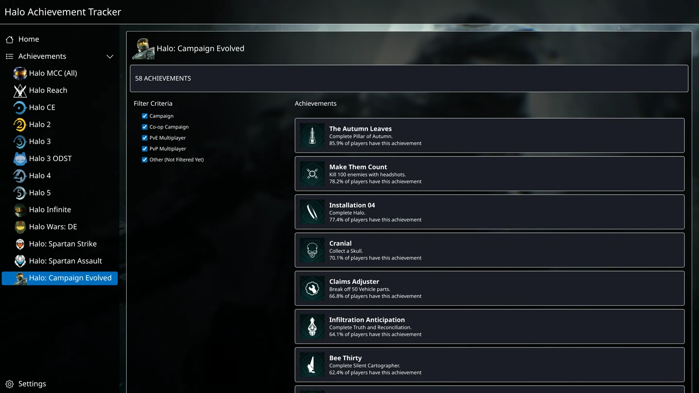

<p align="center">
  
</p>
<h1 align="center">
  Halo Achievement Tracker
</h1>

Browse Halo achievements, filter them by game mode, and open guides where available.

**Current web version:** 1.1.0 (2026/11/22) · [Open the tracker](https://halotracker-org.shaunroselt.chatgpt.site/) · [Release notes](https://halotracker-org.shaunroselt.chatgpt.site/?page=release-notes)



## Repository Status


[](https://wakatime.com/badge/github/shaunroselt/HaloTracker.org)

## Supported Games

- Halo: The Master Chief Collection, including Halo: Reach, Halo: Combat Evolved, Halo 2, Halo 3, Halo 3: ODST, and Halo 4
- Halo 5: Guardians
- Halo Infinite
- Halo Wars: Definitive Edition
- Halo: Spartan Assault
- Halo: Spartan Strike
- Halo: Campaign Evolved

## Current Features

- View achievement descriptions and the percentage of players who unlocked each achievement.
- Filter achievements by campaign, co-op campaign, PvE multiplayer, PvP multiplayer, and other.
- Open written and video guides where available.
- Browse the tracker on desktop and mobile. Open the release history from Settings.

## Planned Features

- Further improvements to mobile support, achievement guides, and filters
- Achievement sorting
- Steam and Xbox player lookup and achievement comparisons

## Platform Support

The web tracker targets Baseline 2025. Native app downloads are still in development.

## Run the Website Locally

From the repository root, run:

```sh
npm --prefix Website run build
python3 -m http.server 8000 --directory Website/dist/client
```

Open [localhost:8000](http://localhost:8000/). The web source is in [Website](Website/).

## Release Notes

Browse the [release history in the tracker](https://halotracker-org.shaunroselt.chatgpt.site/?page=release-notes) or read [RELEASE_NOTES.md](RELEASE_NOTES.md).

## License

[MIT](LICENSE)
